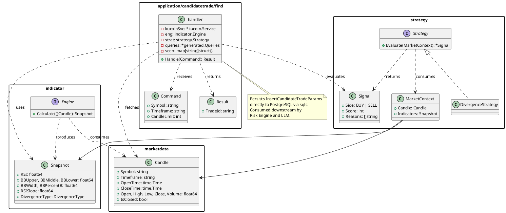

# Claude Code Instructions for trading_bot

## Feature Structure

Every business operation is a `handler.go` file inside `internal/application/{feature}/{operation}/`.

All KuCoin HTTP communication goes through `internal/services/kucoin/kucoin.go` — never in application handlers directly.

### Handler anatomy

Every handler follows this exact pattern (see `candidatetrade/find/handler.go`):

```go
// Command — the handler's input (exported struct).
type Command struct { ... }

// Result — the handler's output (exported struct). Empty Result{} = no action taken.
type Result struct { ... }

// handler — private struct holding injected dependencies.
type handler struct { ... }

// NewHandler — the only exported constructor; returns the shared Handler interface.
func NewHandler(...) app.Handler[Command, Result] { return &handler{...} }

// Handle — implements app.Handler[Command, Result].
func (h *handler) Handle(ctx context.Context, cmd Command) (Result, error) { ... }
```

### Handler registry

| Feature | Operation | Package | Key dependencies |
|---|---|---|---|
| `candidatetrade` | `find` | `application/candidatetrade/find` | `kucoin.Service`, `indicator.Engine`, `strategy.Strategy`, `generated.Queries` |
| `portfolio` | `sync` | `application/portfolio/sync` | `kucoin.Service`, `generated.Queries` |
| `portfolio` | `getsnapshot` | `application/portfolio/getsnapshot` | `generated.Queries` |

### KuCoin service

`internal/services/kucoin/kucoin.go` owns all KuCoin API communication:

- `NewService(baseURL)` — unauthenticated, for public market data (candles)
- `NewAuthenticatedService(baseURL, apiKey, apiSecret, passphrase)` — V2 signature auth for account endpoints
- `GetClosedCandles(ctx, symbol, timeframe, limit)` — fetches candles; reverses to oldest-first
- `GetBalances(ctx)` — spot account balances via `/api/v1/accounts?type=trade`
- `GetOpenOrders(ctx)` — active orders via `/api/v1/orders?status=active&tradeType=TRADE`

Domain types defined in `kucoin` package: `Balance`, `OpenOrder`, `Candle` (via `marketdata`).

## Domain Model

Three core concepts form the signal pipeline:

| Concept | Package | Role |
|---|---|---|
| `Engine` | `indicator` | Computes technical indicators from raw candles |
| `Strategy` | `strategy` | Decides whether market conditions warrant a trade signal |
| `handler` | `application/candidatetrade/find` | Orchestrates the pipeline: fetches candles, evaluates, deduplicates, and persists |

`Snapshot` (output of `Engine`) is the glue — consumed by `Strategy` for decisions and written directly to PostgreSQL via sqlc.

### Signal pipeline flow

```
KuCoin REST API
    │  []Candle (up to 1000 closed candles)
    ▼
indicator.Engine.Calculate()
    │  indicator.Snapshot  (RSI, BB, RSISlope, DivergenceType)
    ▼
strategy.Strategy.Evaluate(MarketContext{Candle, Snapshot})
    │  *strategy.Signal  (nil = no signal, stop here)
    ▼
handler: idempotency key check (in-memory seen map)
    │  duplicate → stop here
    ▼
DB via sqlc InsertCandidateTrade (ON CONFLICT DO NOTHING)
```

### Architecture notes

- There is no intermediate domain object between `Signal` and the database row. The handler builds `InsertCandidateTradeParams` directly.
- In-memory deduplication (`sync.Mutex` + `seen map[string]struct{}`) guards against re-processing the same candle within a single process run. The DB `ON CONFLICT DO NOTHING` on `idempotency_key` guards against duplicates across restarts.
- Idempotency key format: `Symbol:Timeframe:CloseTime:StrategyName:StrategyVersion`
- Business logic (dedup, key generation, persistence) lives in `internal/application/candidatetrade/find/handler.go`, not in separate domain packages.

### PlantUML


